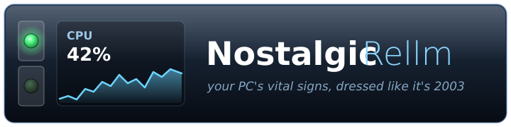

<p align="center"></p>

# Nostalgic Rellm

*[Leia em português](README.pt-BR.md)*

A lightweight, skinnable hardware monitor for Windows: a translucent horizontal bar that sits on top of
the taskbar, inspired by the Enlightenment window manager (E16/E17) and the classic GKrellM.

## About

This project exists because someone misses the golden age of Linux desktops, back when picking an
Enlightenment theme took longer than the actual work, GKrellM blinked tiny LEDs at you from the corner of
the screen, and everything was translucent, beveled and only mildly readable. It was glorious.

Then the world discovered flat design. Very clean. Very efficient. Very beige.

So here's a hardware monitor that refuses to grow up. It won't change your life, boost your productivity
or align your synergies. It just shows your CPU usage inside a glass bar with a glowing LED, the way nature
intended. If you were looking for a serious, enterprise-grade monitoring solution, you took a wrong turn
somewhere around 2004.

- CPU % and temperature · RAM % · GPU % and temperature · VRAM % · used space of every disk (label + letter)
- GKrellM-style history graphs (toggle in the menu)
- Click CPU, RAM, GPU or VRAM: translucent popup with the top 5 processes; click ✕ twice to end one
- **AI** button: session (5 h) and weekly usage of Claude and GPT (Codex)
- Two GKrellM-style LED buttons: collapse down to just the LEDs, and dock to the top of the screen
  reserving that strip (maximized windows start below it)
- Hides itself while a game, video or presentation is full screen
- JSON skins, picked from the right-click menu; English and Brazilian Portuguese, with translation files
- Single portable exe, no tray icon; ~0.1% CPU and ~50 MB of private memory

## Download

Two builds are published on the Releases page:

| Build | Size | Needs |
|---|---|---|
| `NostalgicRellm.exe` | ~5 MB | [.NET 10 Desktop Runtime](https://dotnet.microsoft.com/download/dotnet/10.0) installed |
| `NostalgicRellm-full.exe` | ~50 MB | nothing, .NET is bundled |

The exe is not code-signed, so Windows SmartScreen shows an "unrecognized app" warning the first time
(More info → Run anyway). Because it asks for administrator rights and reads low-level sensors, some
antivirus tools may flag it; the source is all here to check.

## Requirements

- Windows 10/11 x64
- The bar relaunches itself as administrator (needed to read CPU temperature and end other users' processes).
  `--no-elevate` starts it without asking, minus the CPU temperature.
- **CPU temperature:** also needs the [PawnIO](https://pawnio.eu) driver. Without it the CPU shows `--°C`
  and everything else works.

## Usage

| Action | Effect |
|---|---|
| Drag | Moves the floating bar (snaps to the top and bottom edges of the main screen) |
| Click CPU/RAM/GPU/VRAM | Opens or closes the top 5 processes |
| Click AI | Opens Claude and GPT usage |
| Top LED | Collapse to the LEDs ↔ expand |
| Bottom LED | Dock to the top of the screen ↔ float again |
| Right-click | Skin, graphs, collapsed, docked, Connections…, language, skins folder, exit |

Position and preferences live in `settings.json` next to the exe. `"Height": 0` follows the taskbar height.

## AI usage

Nobody types a password or token anywhere. Right-click → **Connections…** shows the state of each one.

- **Claude** comes from Claude Code's official [status line](https://code.claude.com/docs/en/statusline).
  **Connect** adds this to `~/.claude/settings.json` (asking first, and warning if you already have a status line):

  ```json
  "statusLine": { "type": "command", "command": "\"C:/path/NostalgicRellm.exe\" --statusline" }
  ```

  On every refresh Claude Code hands over the session and weekly usage (Pro and Max plans); the monitor keeps
  the last reading in `%LOCALAPPDATA%\NostalgicRellm\claude-usage.json`. The numbers cover your whole plan
  (app, web and terminal), but only refresh while Claude Code runs in a terminal. No Claude credential is read.
- **GPT** uses the sign-in the Codex app already saved in `~/.codex/auth.json`, and shows Codex limits (not
  ChatGPT chat). The endpoint is undocumented and may change. The token is only read, never refreshed by
  the monitor, sent only to OpenAI, and only while the AI popup is open.

## Skins

Each skin is a folder in `skins/` with a `skin.json` (colors as `#RRGGBB` or `#AARRGGBB`); missing fields
use the defaults. The bundled skins are E17 Glass, E16 Bevel, GKrellM Classic and Minimal. An optional PNG
background is set with `"backgroundImage": "background.png"`.

## Translations

Built-in languages live in `src/lang/<code>.json` (key → text). To add or tweak a language without
rebuilding, drop a `lang/<code>.json` next to the exe: it overrides the built-in file with the same code or
adds a new language to the menu. Missing keys fall back to English.

## Building

```
cd src
dotnet publish -c Release -o ../publish
dotnet publish -c Release -o ../publish-full --self-contained true
```

Sensor diagnostics (writes `dump.txt` next to the exe):

```
NostalgicRellm.exe --dump
```

## License

[0BSD](LICENSE): do anything with it, no attribution required.

Sensors are read with [LibreHardwareMonitor](https://github.com/LibreHardwareMonitor/LibreHardwareMonitor)
(MPL-2.0), which is bundled in the exe; its source is available at that link.
